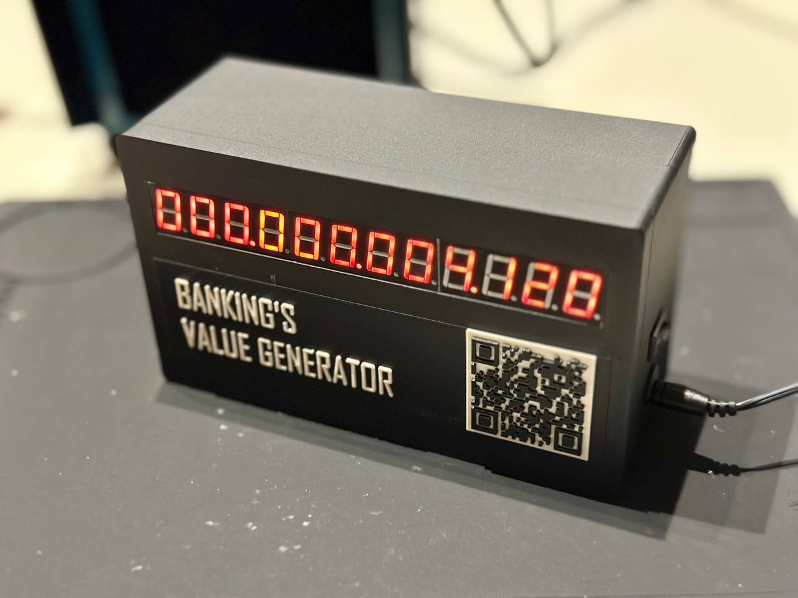
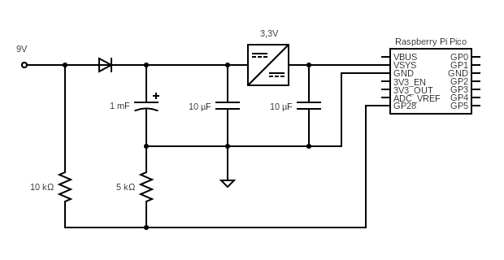

# Xepelin banking's value generator

RP2040 firmware for the value generating machine of Xepelin's banking team.



This project consists of 100% grass fed, free range and LLM free code.

## The cool part

The generator stores in its flash the current value in order to resume its generation at the same
point after a power off. To achieve this without obliterating the sbc's memory writes are only
achieved when a loss of power is detected and whilst the board is running in power stored in
a capacitor. The power circuit that allows for this is depicted bellow:



The line that comes out of the voltage divider is connected to the `GPIO28` pin which is set up as
pull-down input and on an edge low triggers an interrupt that runs the counter write sequence.

> [!WARN]
> Shorting the `GPIO0` pin to ground will reset the counter!

## Building and flashing firmware

To build the firmware you will need to install
[rust](https://www.rust-lang.org/), the toolchain for the ARM Cortex-M0+
[target](https://doc.rust-lang.org/rustc/platform-support/thumbv6m-none-eabi.html),
tooling to convert the elf binary to uf2
([elf2uf2-rs](https://github.com/JoNil/elf2uf2-rs) seems to be the de facto
tool for doing it) and the [lld](https://lld.llvm.org/) linker. With this
requirements met, running the following commands at the root of the project
will build our firmware.

```bash
cargo build --profile lto &&
elf2uf2-rs target/thumbv6m-none-eabi/lto/value-counter
```

To flash the firmware: set your board into bootloader mode, mount the board's
mass storage device to your computers file system and copy the file
`target/thumbv6m-none-eabi/lto/value-counter.uf2` to it.

> [!NOTE]
> Assuming there is no automatic drive mounting and that no other SATA
> drives are connected, the `build.sh` script will do the previous steps
> automatically (possibly leaving you with a new `/mnt/usb1` directory). The
> script is there only for my own convenience but it might prove useful to you.
